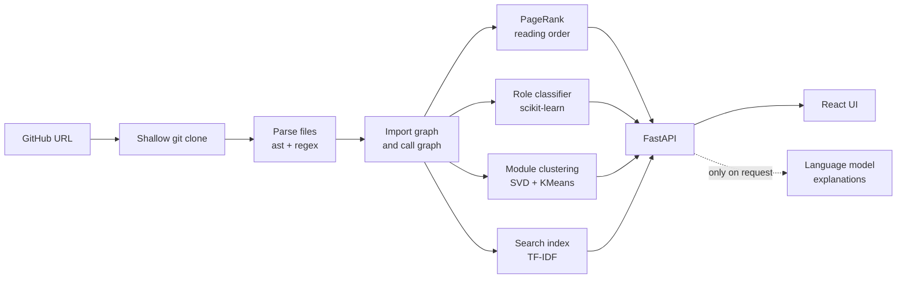

# CodeFlow

Paste a public GitHub repository. CodeFlow clones it, parses it, and shows you what imports what, which files to read first, and plain-language notes on each file.

[](https://github.com/YOUR_USERNAME/YOUR_REPO/actions)

<!-- Add a screenshot or short GIF here:  -->

The structure comes from static analysis, not from a language model. A language model only writes the text explanations, and only when you press a button. That keeps the diagrams grounded in the real import graph instead of a model's guess.

## Features

- **Architecture map.** The most-imported files, grouped by folder, as a clickable diagram. Click a box to open that file.
- **Reading order.** Starts at the entry point and follows its imports, so you know what to open first.
- **File roles.** Each file is labelled entry, api, model, data, training, evaluation, config, util or test by a scikit-learn classifier that you train.
- **Module discovery.** Unsupervised clustering groups files by their code and their place in the import graph.
- **Code search.** TF-IDF search over identifiers, imports and path names.
- **Function flowcharts.** A control-flow chart for any Python function.
- **Data-flow trace.** The shortest chain of calls from an HTTP route (or any function) to a target such as `db` or `save`.
- **Pull-request impact.** Give it a PR URL or a diff and see which files it touches and which files depend on them.
- **Export.** Copy Mermaid, download `.mmd` or PNG, or copy a ready-made README block.
- **File and repo explanations.** Written by a language model of your choice (Groq, Gemini, Anthropic, or a local model through Ollama or LM Studio).

## How it works



## The machine learning

| Component | Method | Trained on |
|---|---|---|
| File-role classifier | TF-IDF on code tokens plus graph numbers, logistic regression | Files from many GitHub repos, with weak labels taken from path rules |
| Module discovery | TF-IDF and SVD for the code, SVD of a random-walk matrix for the import graph, KMeans with *k* chosen by silhouette score | Nothing (unsupervised) |
| Code search | TF-IDF over identifiers, imports and path words | Built per repository on demand |

**The classifier never sees file paths.** The path rules create the training labels, so the model has to learn what a "training file" or a "config file" looks like inside. That lets it label files whose names give nothing away.

**It is evaluated on repositories it has never seen.** Files from one repository share naming habits and vocabulary. If some of a repo's files were in training and others in the test set, the model could score well just by recognising the repo. So the cross-validation holds out whole repositories.

### Results

Leave-repos-out cross-validation on 2,142 labelled files from 28 repositories. These are numbers from one run; yours will differ a little because repositories change.

| Model | Macro-F1 | Accuracy |
|---|---|---|
| Majority class (baseline) | 0.066 | 0.433 |
| Graph and size numbers only | 0.185 | 0.340 |
| **Code tokens only (selected by cross-validation)** | **0.386** | 0.593 |
| Code tokens + numbers | 0.375 | 0.573 |

Per-class F1: test 0.84, model 0.62, training 0.51, data 0.43, util 0.37, evaluation 0.31, config 0.21, entry 0.17, api 0.12.

**How to read this.** The model clearly beats the baselines, and the tokens it learned are sensible (training: `loss`, `trainer`, `optimizer`; model: `layer`, `conv`). But it is modest. The `api`, `entry` and `config` classes are weak. And because the labels come from path rules, these scores measure agreement with the rules on unseen repositories, not accuracy against ground truth.

### Hand-labelled evaluation

The honest test is against labels a person assigned by reading the files, on repositories not used for training.

| Method | Accuracy | Macro-F1 |
|---|---|---|
| Keyword rules | _fill in_ | _fill in_ |
| Trained model | _fill in_ | _fill in_ |

_Results to be added after running `python -m ml.eval_gold` (see "Training the role classifier" below)._

## Quick start

You need Python 3.11+, Node.js 18+ and Git.

### 1. Backend

```bash
python -m venv .venv
source .venv/bin/activate          # Windows PowerShell: .\.venv\Scripts\Activate.ps1
python -m pip install -r requirements.txt
python -m pytest -q                # all tests should pass
```

Create a `.env` file in the project root (see [Configuration](#configuration)), then:

```bash
python -m uvicorn app.main:app
```

### 2. Frontend

In a second terminal:

```bash
cd frontend
npm install
npm run dev
```

Open <http://localhost:5173>. The dev server forwards `/api` to the backend on port 8000.

Without the React app, the backend also serves a simple single-file page at <http://127.0.0.1:8000>.

### 3. One server (optional)

```bash
cd frontend && npm run build
```

When `frontend/dist` exists and the backend is set up to serve it, you only need to run the Python server. See the frontend guide for the small change to `app/main.py`.

## Configuration

Settings come from environment variables or a `.env` file in the project root. Real environment variables win over the file. Never commit `.env`.

| Variable | Default | Meaning |
|---|---|---|
| `LLM_PROVIDER` | `openai` | `openai` (any OpenAI-compatible server), `ollama` or `anthropic` |
| `OPENAI_API_KEY` | empty | Key for Groq, Gemini, OpenAI and similar |
| `OPENAI_BASE_URL` | Groq's URL | For example `https://generativelanguage.googleapis.com/v1beta/openai/` for Gemini |
| `OPENAI_MODEL` | `llama-3.3-70b-versatile` | **Model names change often.** Run `python -m app.check_llm` to list what your key can use, then set this |
| `OLLAMA_URL`, `OLLAMA_MODEL` | `http://localhost:11434`, `qwen2.5-coder:7b` | Local models through Ollama |
| `ANTHROPIC_API_KEY`, `ANTHROPIC_MODEL` | empty, `claude-sonnet-5-5` | Anthropic API |
| `ROLE_MODEL` | `models/role_clf.joblib` | Path to the trained role classifier |
| `CACHE_DIR` | `.cache` | Cloned repositories and cached explanations |

Example `.env` for Groq (two separate lines):

```
OPENAI_API_KEY=your_key_here
OPENAI_MODEL=a_model_name_from_check_llm
```

Restart the server after editing `.env`; it is only read at startup.

**If the Explain buttons fail**, run `python -m app.check_llm`. It reports a missing or rejected key, an unavailable model name, or a rate limit.

Free API tiers are rate-limited, and your code is sent to the provider. For private code use a local model.

## Training the role classifier

Until you train one, file roles come from keyword rules in the path.

```bash
# 1. Build a feature dataset from the repos listed in ml/repos.txt (clones them, takes a few minutes)
python -m ml.build_dataset ml/repos.txt data/dataset.csv 200

# 2. Train, compare against baselines, and save the best model
python -m ml.train data/dataset.csv models/role_clf.joblib
```

Restart the backend afterwards so it loads the model. Add more varied repositories to `ml/repos.txt` and re-run to improve it.

To measure it against human judgement:

```bash
python -m ml.build_dataset ml/gold_repos.txt data/gold_dataset.csv 200   # repos NOT in repos.txt
python -m ml.make_gold data/gold_dataset.csv data/gold_to_label.csv 100
# open data/gold_to_label.csv and fill the true_role column (read each file first;
# hide the model_pred and keyword_rule columns while you label, so they do not sway you)
python -m ml.eval_gold data/gold_to_label.csv
```

## Project structure

```
.
├── app/                 FastAPI backend
│   ├── main.py          endpoints
│   ├── parser.py        imports, functions, calls, routes (ast for Python, regex for JS/TS)
│   ├── graph.py         import graph, PageRank, reading order, Mermaid output
│   ├── flowchart.py     function-level flowcharts
│   ├── dataflow.py      call graph and tracing
│   ├── diff.py          pull-request impact
│   ├── features.py      ML features
│   ├── roles.py         file-role classifier
│   ├── embed.py         module clustering
│   ├── search.py        code search
│   ├── llm.py           language-model access, retries, caching
│   └── check_llm.py     diagnoses your LLM setup
├── ml/                  dataset building, training, hand-labelled evaluation
├── eval/                LLM-only baseline for import extraction
├── tests/               backend tests
├── static/              original single-file page (fallback)
├── frontend/            React + TypeScript + Vite app
├── Dockerfile
└── docker-compose.yml
```

## API

All endpoints are `POST` with a JSON body that includes the repository `url`. Interactive docs are at `/docs` when the backend is running.

| Endpoint | Returns |
|---|---|
| `/api/analyze` | Stats, architecture diagram, reading order |
| `/api/roles` | A role and confidence for every file |
| `/api/modules` | Clusters, quality metrics, diagram |
| `/api/search` | Files matching a query |
| `/api/file` | Functions, imports, importers and source for one file |
| `/api/file_summary`, `/api/summary` | Language-model explanation of a file or the repo |
| `/api/flowchart` | Control-flow chart for a Python function |
| `/api/trace` | Call path from an entry point to a target |
| `/api/diff` | Files changed by a PR and files affected by it |

## Testing

```bash
python -m pytest -q          # backend
cd frontend && npm run typecheck
```

## Limitations

- **Python gets the deep analysis.** JavaScript and TypeScript get imports, function names and routes from regular expressions, with no function flowcharts or call graph.
- **Name-based matching.** Two modules or functions with the same name in different places can be confused.
- **Weak labels.** The classifier is trained on labels from path rules, which are noisy. Its `api`, `entry` and `config` predictions are weak.
- **Clusters are suggestions.** Low silhouette scores mean the groups overlap.
- **Search compares words, not meaning.**
- **PR impact reads the repository's default branch**, not the pull request's own commit.
- **Public repositories only.**
- **Explanations can be wrong.** They are written by a language model. Check them against the code.
- **Not ready for public hosting.** Anyone who can reach the server can make it clone arbitrary repositories. Add rate limiting, authentication and a clone size limit before exposing it.
- **Docker files are untested**, and the image serves the single-file page, not the React build.

## Troubleshooting

- **`An Application Control policy has blocked this file` (Windows).** Smart App Control or an organisation policy is blocking a compiled file in a Python package or a command like `uvicorn.exe`. Run tools through Python (`python -m uvicorn ...`, `python -m pytest ...`). If a package such as scikit-learn is blocked, try another version, turn off Smart App Control on a personal machine, or run the project inside WSL2.
- **"Cannot reach the backend" in the UI.** The Python server is not running on port 8000.
- **`401` or `model not found` from the language model.** Run `python -m app.check_llm`.
- **File roles say "keyword rules".** Train the classifier and restart the backend.

## Roadmap

- Tree-sitter parsing for real multi-language call graphs
- Embedding-based search instead of TF-IDF
- A graph neural network over the import graph for role prediction
- Active learning: ask the user to label the model's least-confident files, then retrain

## License

Add a license (for example MIT) and your name here.

## Credits

The click effect component comes from Originkit. Check its license terms before publishing the project. Diagrams are rendered with [Mermaid](https://mermaid.js.org), animation uses [GSAP](https://gsap.com).
